<div align="center">

# nodepad

**nodepad is an AI office suite where teams co-edit docs, slides, sheets, 3D and media live, and an AI listens to your voice or Zoom call and makes the edits you ask for in real time.**

Slides · Docs · Sheets · Notes · Whiteboards & dev diagrams · 3D scenes · Music & video

Built at **HackTX 2026** · Meta (Muse Spark) track · SerpApi track

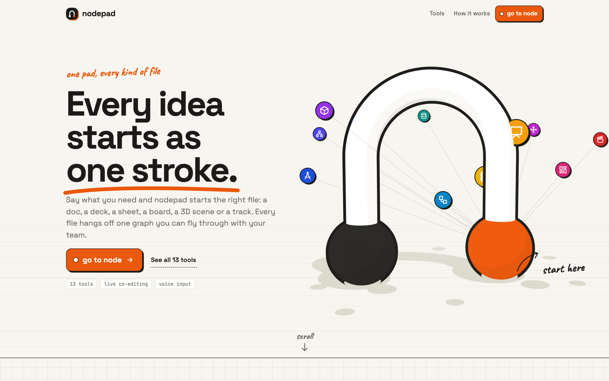

</div>

---

## Contents

- [What it is](#what-it-is)
- [What you can do with it](#what-you-can-do-with-it)
- [Screenshots](#screenshots)
- [How it works](#how-it-works)
- [Architecture](#architecture)
- [Tech stack](#tech-stack)
- [Run it locally](#run-it-locally)
- [Deploy](#deploy)
- [Project layout](#project-layout)
- [API reference](#api-reference)

---

## What it is

Most AI writing tools hand you a finished blob of text to paste somewhere. nodepad works the other way around: the AI is a **collaborator inside the file**. It never rewrites the whole document. Instead it streams small, typed edits ("add a slide", "set cell B4 to `=SUM(B2:B3)`", "connect the API node to the database"), and each one lands in front of everyone the moment it is made.

That one idea gives you a lot for free:

| Because every change is a small typed operation… | …you get |
| --- | --- |
| Edits stream as they are generated | The document builds itself live instead of after a long spinner |
| Every op has an inverse | Undo any single AI edit, a whole AI response, or your own last change |
| Humans and the AI send the same ops | Real-time multiplayer co-editing with presence, no special cases |
| Ops are validated with a shared Zod schema | A bad model line is dropped, never corrupts the file |
| The server holds the one true document | Late joiners get a snapshot and stay in sync |

You can talk to it three ways: **type** a request, **hold Space** to speak, or turn on **Listen** and share your Zoom, Meet or Teams tab. nodepad hears the call, ignores the small talk, and acts when the room agrees on a change. Its cursor, labeled **node**, moves through the file as it works, so everyone can see what it is touching.

---

## What you can do with it

### Classic office

| Tool | What nodepad does |
| --- | --- |
| **Presentation** | Builds and restyles decks with 9 themes (Classic, Notebook, Midnight, Editorial, Brutalist, Terminal, Sunset, Blueprint, Pastel). Finds **real photos** and **cited facts** on the web through SerpApi, or draws illustrations with Muse Image. Drag, resize, speaker notes, present mode and PDF export. |
| **Document** | Writes and edits rich text block by block: headings, lists, checklists, callouts, code, images. Exports to a file. |
| **Spreadsheet** | Fills cells, writes formulas (a built-in engine with ranges and common functions), formats numbers, sorts, freezes panes and adds bar, line and pie charts. Exports to CSV. |
| **Notes** | Creates, tags, pins and colours notes and checklists, and summarizes or reorganizes them on request. |

### Dev & design boards

One infinite-canvas engine with six templates, so each feels like its own tool:

| Template | Good for |
| --- | --- |
| **Whiteboard** | Brainstorms, retros, sticky notes, freehand pen, AI-drawn sketches |
| **Flowchart** | Login flows, checkout processes, CI/CD pipelines |
| **System design** | Architecture diagrams with service icons (clients, APIs, queues, databases) |
| **DB schema** | Entity-relationship diagrams with typed tables |
| **Mind map** | Idea maps and study maps with automatic layout |
| **Blueprint** | Floor plans with rooms, walls, doors, windows and fixtures |

### 3D & media

| Tool | What nodepad does |
| --- | --- |
| **3D Studio** | Builds scenes from primitives you can sculpt (bulge, taper, twist) in environments like forest, desert or moon. Generates full textured 3D models from a description with **Meshy**, rendered with three.js. |
| **Music** | Generates tracks from a prompt (Replicate, Lyria 2) and gives you mp3, the original file and a waveform video. |
| **Video** | Generates 5 or 10 second clips in 16:9, 9:16 or 1:1 (Replicate, Seedance) and gives you mp4 and mov. |

### Everywhere

- **Accounts and your own workspace.** Sign up with a username and password; the home screen shows only your files and the ones shared with you.
- **Live co-editing.** Click **Invite** to copy a link. Anyone signed in who opens it joins the file, sees who else is in the room, and the file is added to their workspace. Everyone sees the AI's edits stream in and can edit at the same time.
- **The node cursor.** The AI has its own cursor labeled **node** (a pen in docs, slides and boards, an active-cell tag in sheets) that follows each edit as it lands.
- **Voice.** Hold Space to talk; Muse Voice transcribes the clip and it becomes a request.
- **Listen mode.** Leave the mic open, or share a **Zoom, Google Meet or Teams** tab so nodepad hears the whole call. When a call is shared, nodepad listens to the meeting audio only, so your laptop mic does not hear the call a second time. It captions what it hears, separates speakers, and only acts on real requests ("yeah, let's add a pricing slide").
- **Live research.** A research router picks the SerpApi engines a request needs: Google Finance for stock prices, Finance Markets, Google Trends, Google News, Google Scholar, YouTube transcripts, or plain web search. The figures go into the prompt with their dates and URLs, so a slide about "NVDA this year" uses real numbers and cites them.
- **Interrupt anytime.** A new request cancels the one in flight and both get done together.
- **Undo that understands the AI.** Undo one op, a whole AI turn, or your own last edit, with redo.
- **Landing page.** A three.js scene of the nodepad logo wired to every tool. Click **go to node** to fly into it and land on your home screen.
- **Workspace home.** Your files appear on the node-cloud home screen, sorted by recent activity. The owner can delete a file for everyone; anyone else removes it from their own list.

---

## Screenshots

| | |
| --- | --- |
| 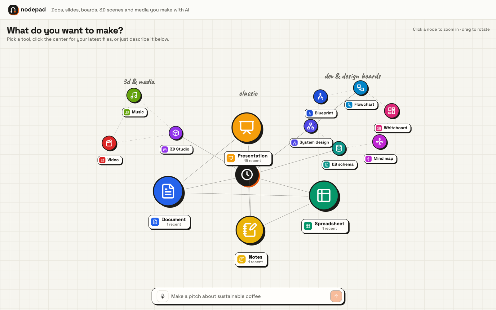 **Home**, a node cloud of every tool and your recent files | 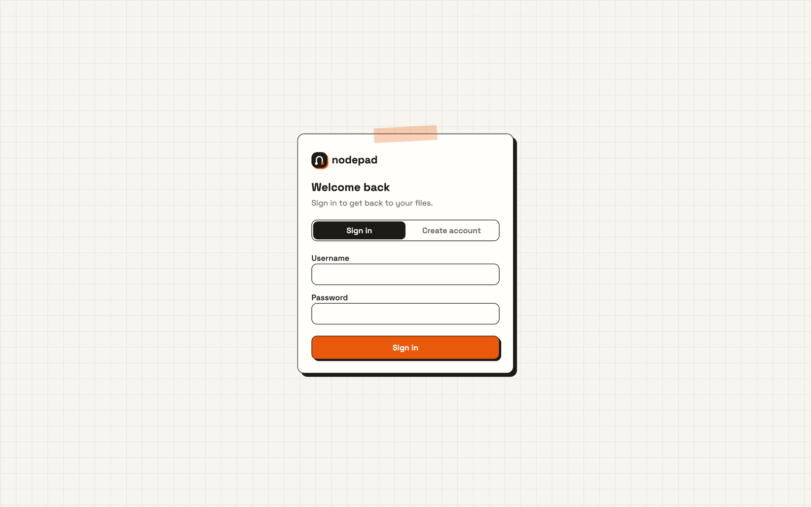 **Sign in** to your own workspace |
| 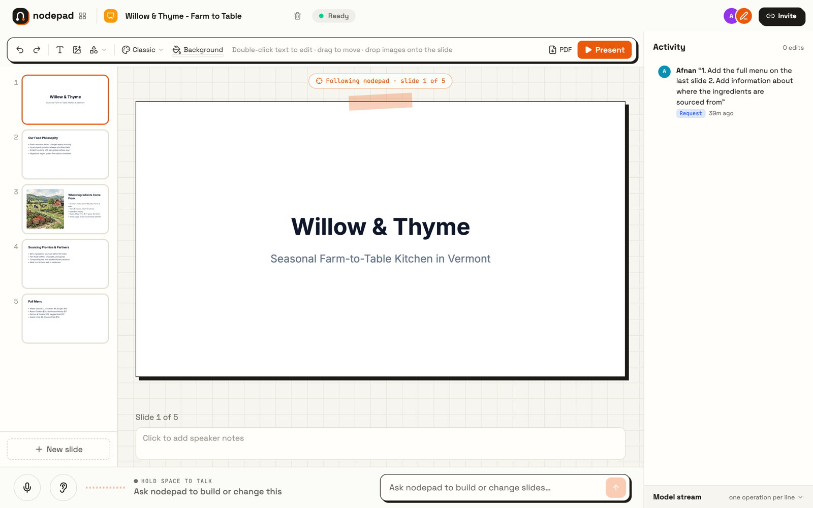 **Presentation** with sourced images, activity feed and voice bar | 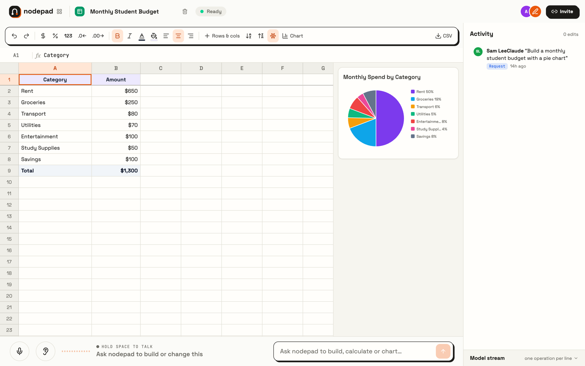 **Spreadsheet** with totals and a generated pie chart |
| 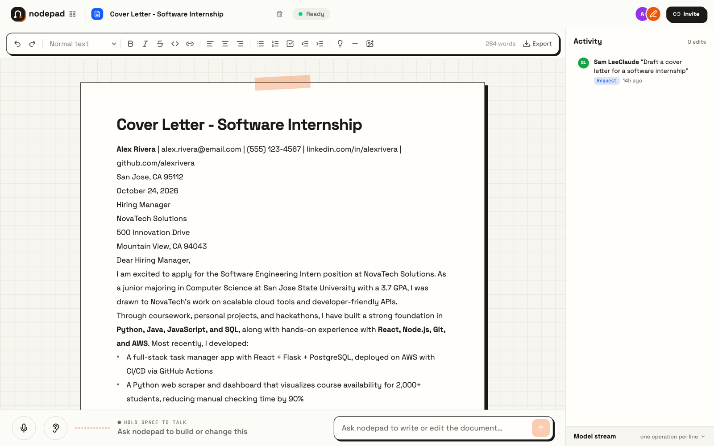 **Document** written from a one-line request | 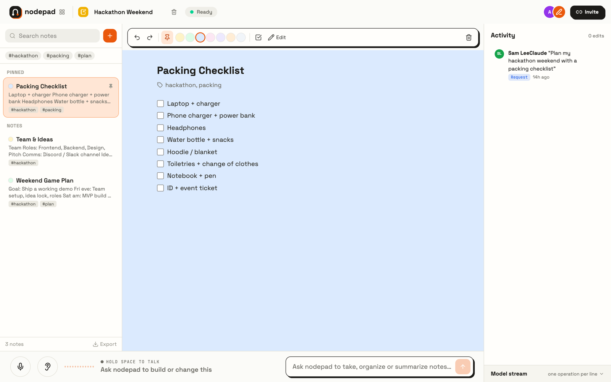 **Notes** with tags, pins and checklists |

---

## How it works

### One request, end to end

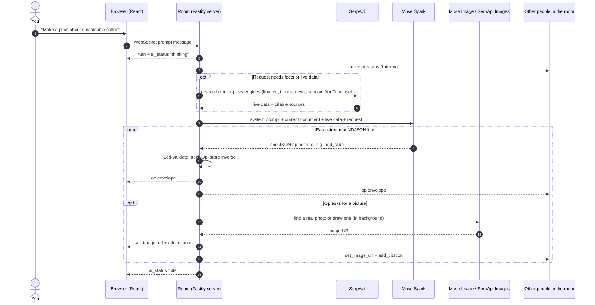

### The operation pipeline

Every edit, whether it comes from the model or from someone dragging a shape, goes through the same path:

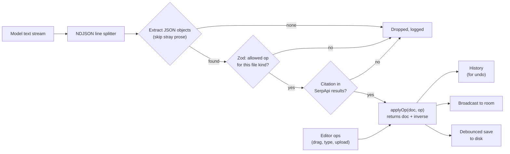

Two rules keep the AI honest:

1. **Per-kind allowlists.** A deck only accepts slide ops, a sheet only sheet ops, and so on (`MODEL_OPS` in `shared/`). The model cannot reach outside the file type it is editing.
2. **Grounded citations.** An `add_citation` is only kept if its exact title and URL came back from SerpApi for this request, so sources on a slide are real.

### Listen mode

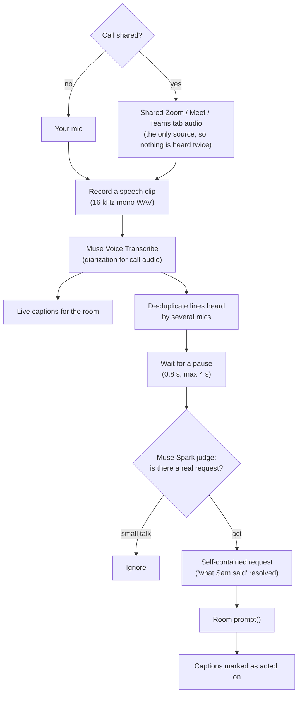

Saying "hey nodepad" skips the judge and acts right away.

### Interruptions and undo

When a new request arrives while the AI is still streaming, the room aborts the stream and re-prompts with **every unfinished request**, so two people talking at once both get what they asked for. Each applied op stores its inverse, which powers three kinds of undo:

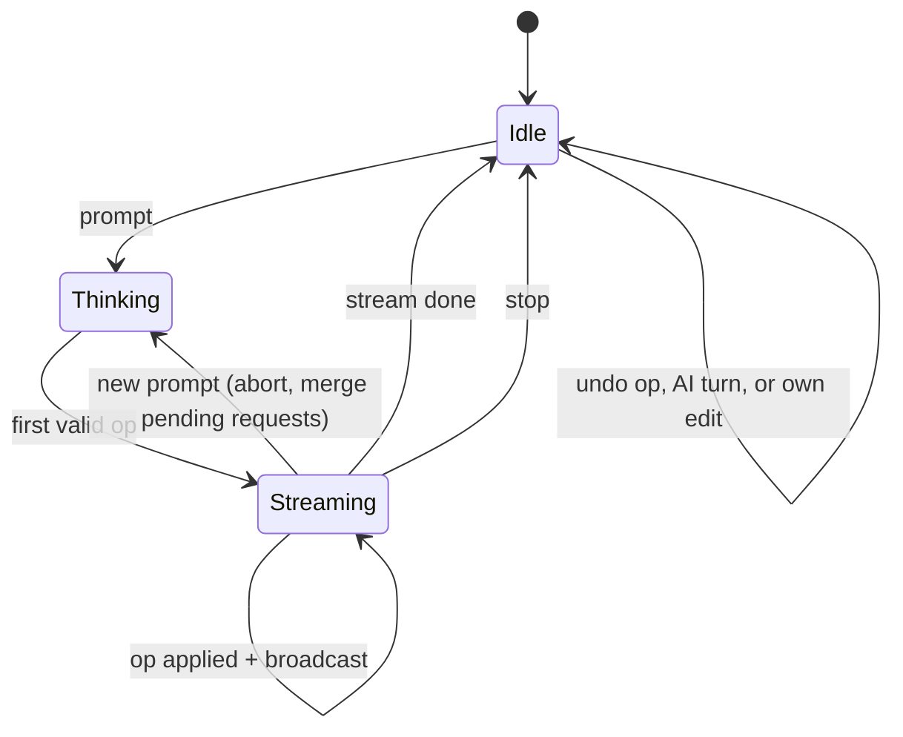

---

## Architecture

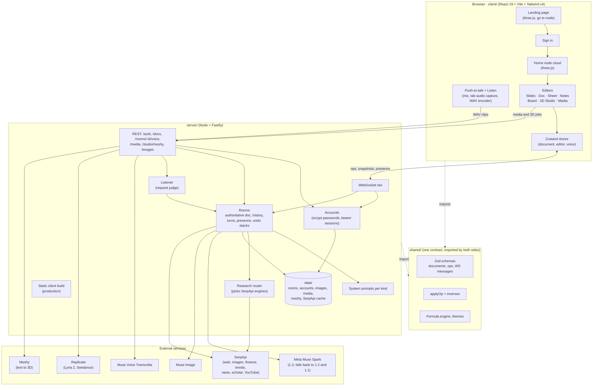

### Key design decisions

- **Accounts own files.** Each file records an owner and the accounts that can open it. Opening an invite link while signed in grants access, which is all sharing needs. The first account created takes over files saved before accounts existed.
- **Server-authoritative rooms.** One `Room` per file owns the document. Clients apply their own edits optimistically and send them as ops; if one is rejected, the server sends that client a fresh snapshot.
- **Shared contract.** `shared/` holds every schema and the pure `applyOp` function, so the browser and the server run identical logic and TypeScript catches drift at compile time.
- **NDJSON over a chat API.** Muse Spark speaks the OpenAI Chat Completions protocol, so the official `openai` SDK streams it with a custom base URL. The system prompt asks for one JSON op per line, which is easy to parse incrementally and easy to reject line by line.
- **Resilient model calls.** If the primary Muse Spark model is unavailable, the server retries and then walks a fallback chain (`MUSE_FALLBACK_MODELS`). Lines with stray prose or markdown around the JSON are still recovered.
- **Images never block text.** Pictures are requested by description; up to four are drawn or found in the background while the rest of the response keeps streaming, then land as a normal op.
- **Works offline.** With no `MUSE_API_KEY`, a mock stream builds a slide so the whole pipeline runs. `MUSE_FIXTURE` replays a recorded response for tests and demos.
- **Files survive restarts.** Each room is saved as one JSON file under `data/rooms`; generated images, media and 3D models are cached on disk and served by random file name.

### Data model

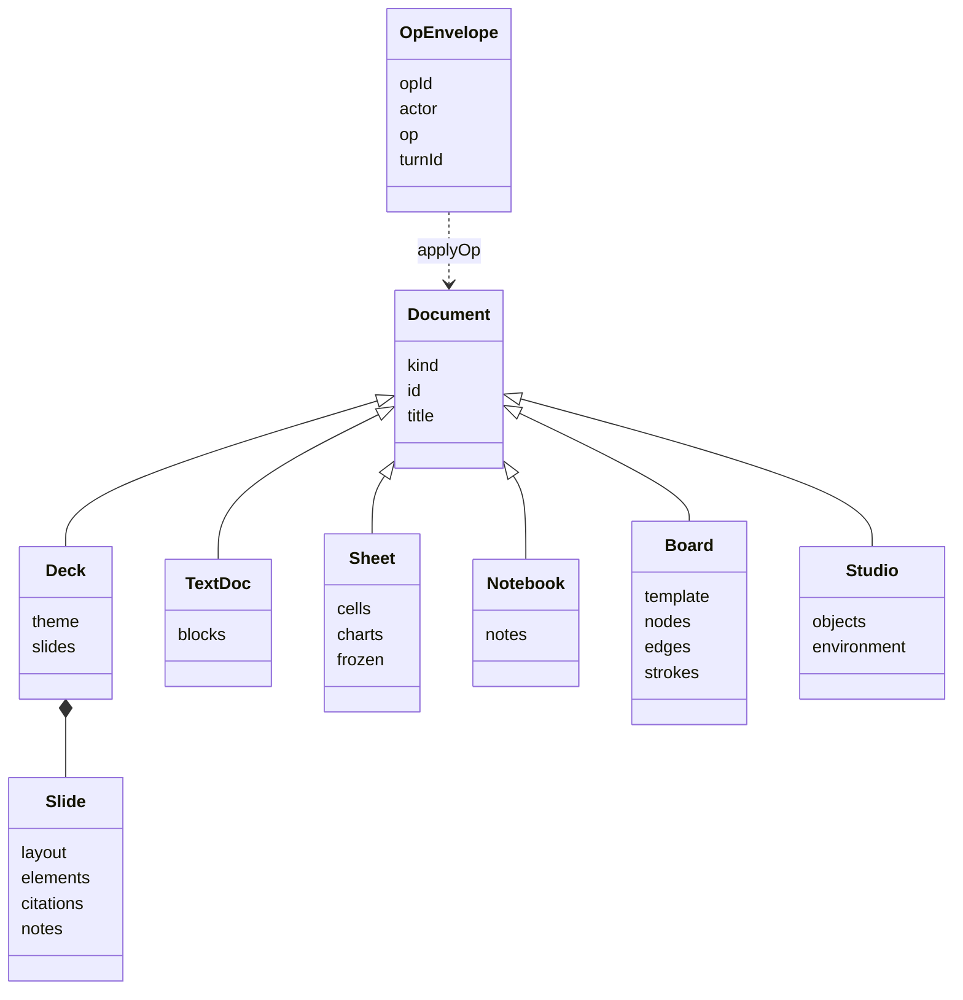

---

## Tech stack

| Layer | Technology | Used for |
| --- | --- | --- |
| **Language** | TypeScript 5.9 across all three packages | One type system end to end |
| **Contract** | Zod 4 | Document, op and WebSocket message schemas, validated at runtime on both sides |
| **Frontend** | React 19, Vite 8 | Editors and the app shell |
| | Tailwind CSS v4, shadcn/ui, Radix, lucide-react | Styling and UI primitives |
| | Zustand 5 | Document, editor and voice state |
| | Framer Motion | Streaming and presence animations |
| | three.js | Landing page fly-in, node-cloud home screen and the 3D Studio viewport |
| | Web Audio + `getDisplayMedia` | Mic levels, WAV encoding and meeting-tab audio capture |
| **Backend** | Node 20+, Fastify 5, `@fastify/websocket`, `@fastify/static` | HTTP API, real-time rooms and serving the built client in production |
| | Node `crypto` (scrypt) | Password hashing and session tokens |
| | `openai` SDK | Streaming Muse Spark and Muse Image |
| | ffmpeg | Converting generated music and video into download formats |
| | tsx | Dev server with watch mode and the test runner |
| **AI and data** | Meta **Muse Spark** | Every edit, plus the Listen-mode request judge |
| | Meta **Muse Image** | Illustrations on slides and boards |
| | Meta **Muse Voice Transcribe** | Push-to-talk and diarized call audio |
| | **SerpApi** | Google web, Images, Finance, Finance Markets, Trends, News, Scholar and YouTube transcripts, cached on disk |
| | **Replicate** | Music (Google Lyria 2) and video (ByteDance Seedance) |
| | **Meshy** | Text-to-3D models (GLB) |
| **Tooling** | npm workspaces, concurrently | One `npm run dev` for client and server |
| **Hosting** | Render (`render.yaml`) | One web service that builds the client and runs the server |

---

## Run it locally

Requires **Node 20+** (and **ffmpeg** if you want music and video downloads).

```bash
npm install
cp .env.example server/.env
npm run dev
```

- App: http://127.0.0.1:5176 (Vite proxies `/api` and `/ws` to the server)
- Server: http://localhost:8787 (`/health`)

Create an account on the sign-in screen (everything past the landing page needs one). To see live co-editing, click **Invite** in a file and open that link in a private window signed in as a second account.

### Configuration

All keys live in `server/.env`. Everything is optional: missing keys switch that feature off or to a mock, so the app always starts.

| Variable | Enables | Without it |
| --- | --- | --- |
| `MUSE_API_KEY` (or `MODEL_API_KEY`), `MUSE_BASE_URL`, `MUSE_MODEL` | AI editing and Muse Image | A mock stream builds a sample slide |
| `MUSE_FALLBACK_MODELS` | Models to try when the primary is unavailable | `muse-spark-1.2,muse-spark-1.1` |
| `MUSE_VOICE_API_KEY` | Voice and Listen mode (defaults to `MUSE_API_KEY`) | Mic buttons report an error |
| `SERPAPI_KEY` | Live research, cited facts and real photos | No lookups; slides use illustrations and skip citations |
| `REPLICATE_API_TOKEN` | Music and video studio | Media tools ask for a key |
| `MESHY_API_KEY` | Text-to-3D models | 3D Studio uses primitives only |
| `MUSE_FIXTURE` | Replays a recorded NDJSON response | |
| `PORT`, `CLIENT_ORIGIN` | Server port and CORS origin | 8787 and the Vite origin |
| `ROOM_DIR`, `AUTH_FILE` | Where files and accounts are saved | `data/rooms` and `data/auth.json` under `server/` |

### Scripts

| Command | What it does |
| --- | --- |
| `npm run dev` | Server and client together, with reload |
| `npm run typecheck` | Type-checks `shared`, `server` and `client` |
| `npm run build` | Production build of the client and a server type check |
| `npm test -w server` | Room and document tests (runs against recorded fixtures) |

---

## Deploy

nodepad ships as **one web service on Render**, described in [`render.yaml`](render.yaml). In production the Fastify server serves the built client, the HTTP API and the WebSocket from one origin, so there is no CORS or proxy setup.

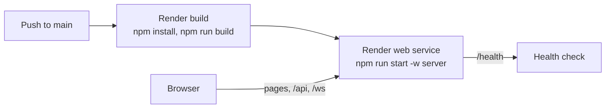

1. Create a Render Blueprint from this repository; it reads `render.yaml`.
2. Fill in the secrets it asks for: `MODEL_API_KEY`, `SERPAPI_KEY`, `MESHY_API_KEY`, `REPLICATE_API_TOKEN`.
3. Every commit to `main` deploys automatically.

The free plan's disk is not persistent, so files and accounts reset when the service restarts. Point `ROOM_DIR` and `AUTH_FILE` at a mounted disk to keep them.

---

## Project layout

```text
.
├── shared/                 The contract, imported by client and server
│   └── src/
│       ├── document.ts     Document union and file kinds
│       ├── deck.ts         Slides, elements, layouts
│       ├── textdoc.ts      Document blocks
│       ├── sheet.ts        Cells, styles, charts
│       ├── formula.ts      Spreadsheet formula engine
│       ├── notes.ts        Notebook
│       ├── board.ts        Boards: nodes, edges, strokes, templates
│       ├── studio.ts       3D scene objects and environments
│       ├── ops.ts          Every op, and which ones the model may send per kind
│       ├── apply.ts        applyOp with inverses (undo)
│       ├── messages.ts     WebSocket messages
│       └── themes.ts       Deck themes
├── server/
│   └── src/
│       ├── index.ts        Fastify routes, the WebSocket endpoint, static client in production
│       ├── auth.ts         Accounts and sign-in sessions
│       ├── rooms/
│       │   ├── room.ts     Rooms: prompting, streaming, images, undo
│       │   ├── listen.ts   Listen mode request judge
│       │   ├── prompts.ts  System prompts and document summaries per kind
│       │   └── store.ts    Saving rooms to disk
│       └── integrations/   muse, voice, image, search, research, media, meshy
└── client/
    └── src/
        ├── components/     Landing, sign-in, home, editors, board, 3D, media, voice, presence
        ├── hooks/          Push-to-talk, Listen, mic level
        ├── store/          Zustand stores
        └── lib/            Auth, socket, landing scene, actions, shortcuts, exports
```

---

## API reference

### WebSocket `/ws`

| Browser → server | Purpose |
| --- | --- |
| `join` | Enter a room with your session `token`, plus the `invite` key from an Invite link for someone else's file (creates it with the given kind if new) |
| `prompt` | Ask the AI for a change |
| `ops` | Direct editor changes (one undo step) |
| `undo` / `undo_turn` | Revert one op or a whole AI response |
| `undo_mine` / `redo_mine` | Your own undo and redo |
| `stop` | Cancel the AI response in flight |

| Server → browser | Purpose |
| --- | --- |
| `snapshot` | Full document, history and turns on join |
| `op` | One applied operation |
| `turn` | A request someone made |
| `presence` | Who is in the room |
| `ai_status` | `idle`, `thinking` or `streaming` |
| `caption` | A line heard in Listen mode |
| `error` | Something to show the user |

### HTTP

Everything except `/auth/*`, `/health` and the image, media and 3D asset downloads needs `Authorization: Bearer <token>`.

| Route | Purpose |
| --- | --- |
| `POST /auth/signup`, `/auth/login`, `/auth/logout` | Accounts; sign-up and sign-in return a session token |
| `GET/PATCH /auth/me` | The signed-in account, and renaming it |
| `GET /docs`, `DELETE /docs/:id` | Your files (yours and shared with you); delete removes it for everyone if you own it, else from your list |
| `POST /rooms/:roomId/voice` | WAV clip in, transcript out (`?mode=listen&source=call` for Listen) |
| `GET /images/:file` | Generated images |
| `GET/POST /media`, `GET/DELETE /media/:id…` | Music and video jobs and downloads |
| `POST /studio/meshy/tasks`, `/refine`, `GET …/tasks/:id`, `…/assets/:id.glb` | Text-to-3D generation |
| `GET /health` | Liveness check |

---

<div align="center">

Made in a weekend at HackTX 2026.

</div>
